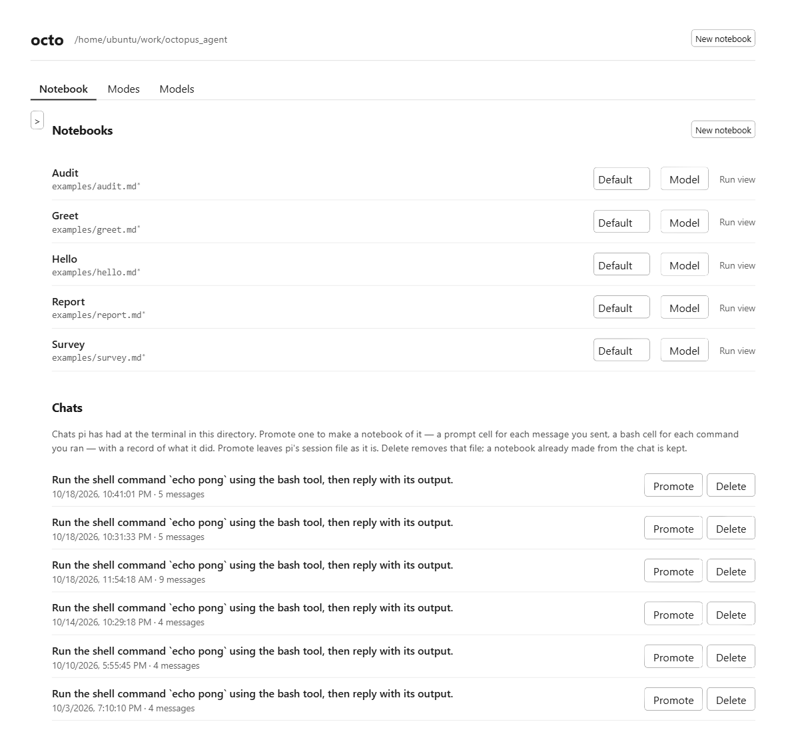
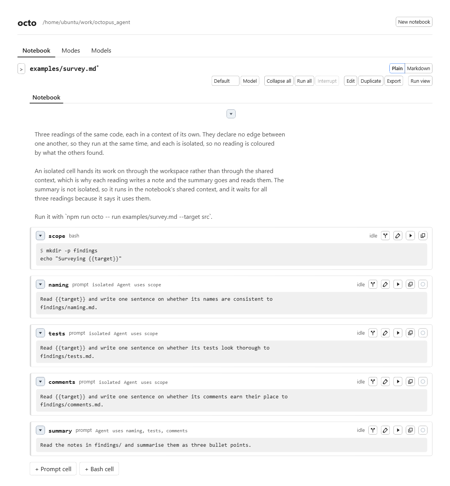
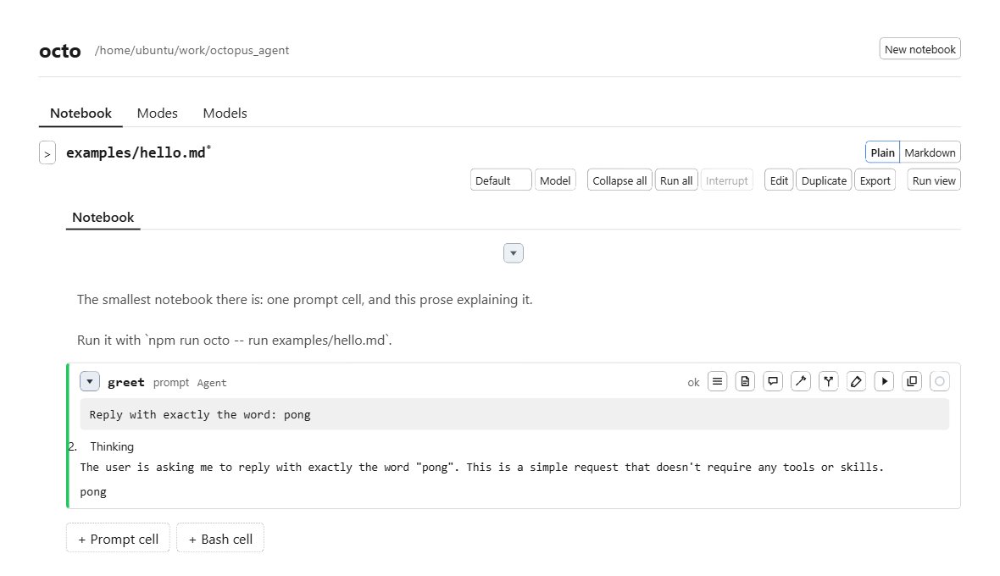
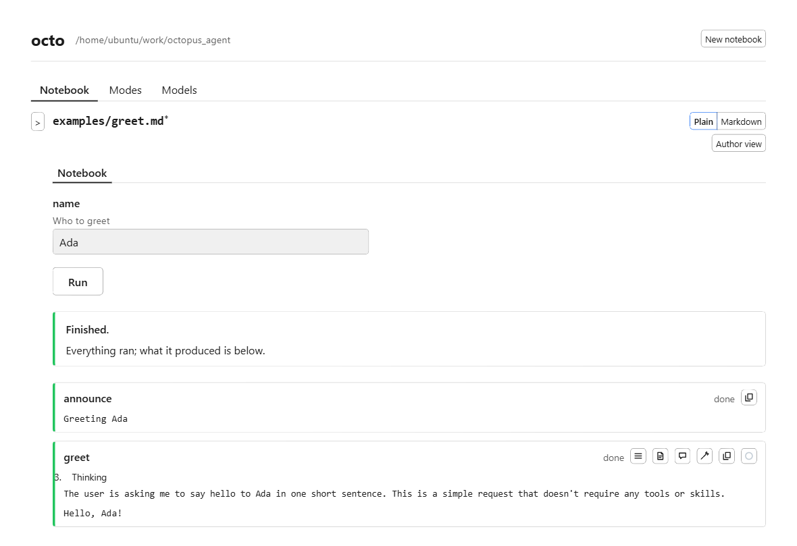
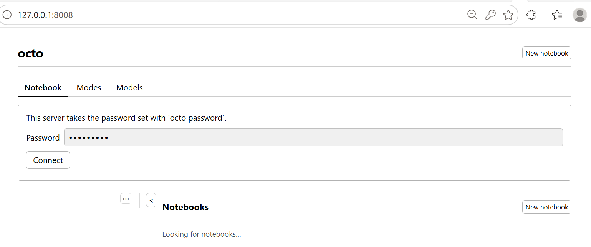
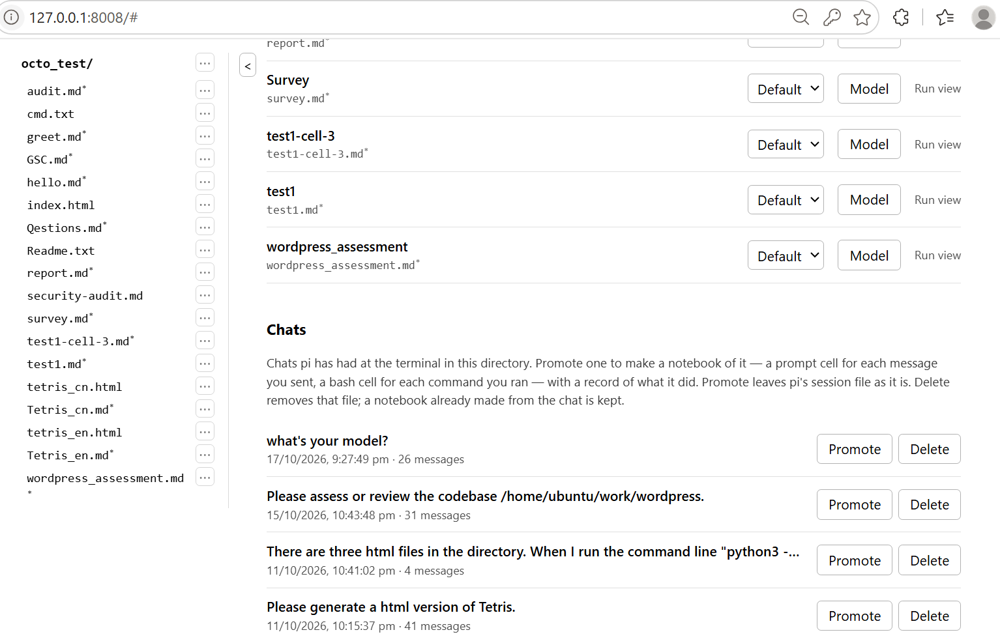
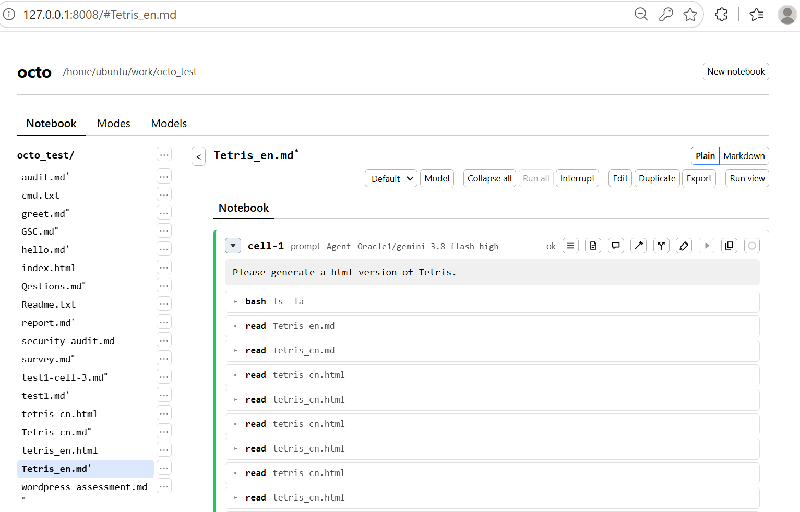
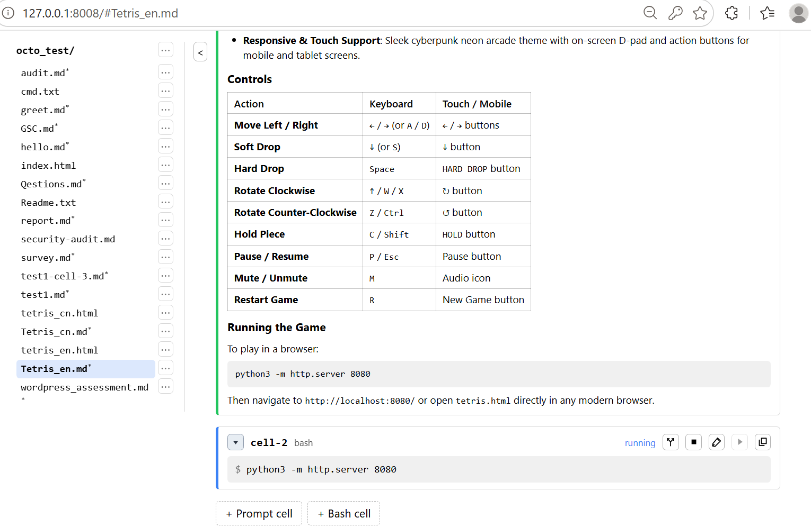
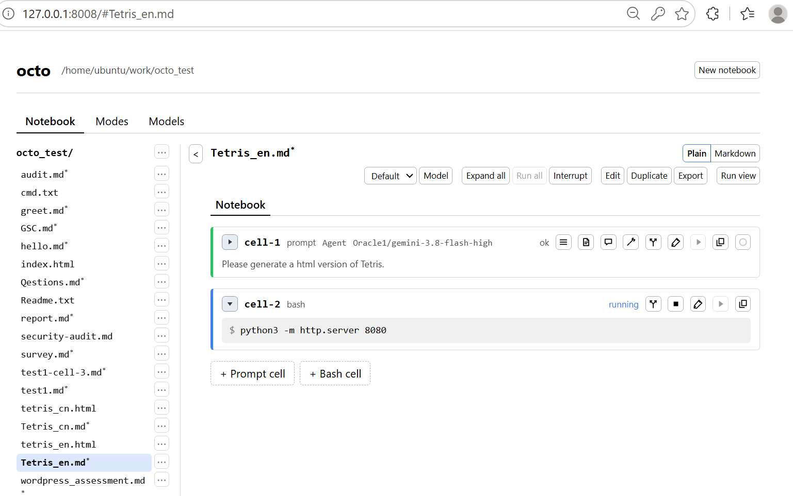
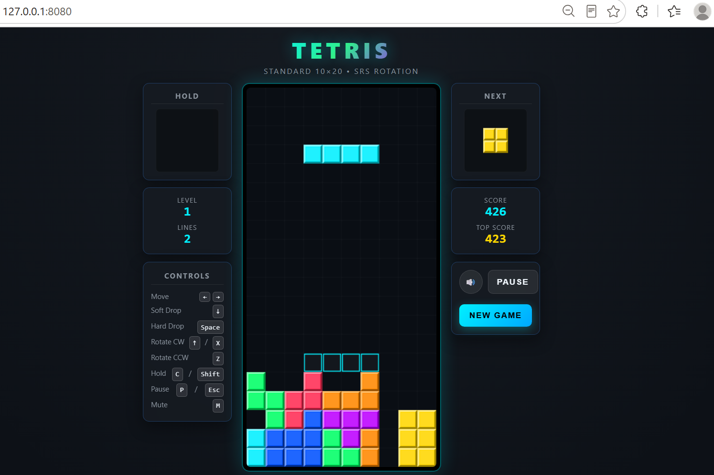

# octo

A notebook environment for agents, built on [pi](https://github.com/earendil-works/pi). Work described once as a readable Markdown document becomes something you can run again, hand to someone else, and review in a pull request.

A **notebook** is the file. A **cell** is an addressable unit inside it: a **prompt cell** is addressed to the agent, and a **bash cell** is a shell command that runs without the agent. Ordinary Markdown between cells is prose. Results live beside the notebook, not inside it.

## Features

Octo keeps a lab notebook for an agent. The Markdown file is the program. A run is something that happened to it. The two stay apart, so a pull request reviews the instructions, and the output of a run stays in the run record.

That split decides the rest of the shape:

- You write the work in the order a person wants to read it. A conclusion can sit at the top of the file and still run last.
- You write every dependency yourself, as `uses` on a cell. Nothing is inferred from the order of the file, and a cycle is refused when the notebook is parsed.
- A bash cell is for the part that should come out the same every time, and it costs no model call. A prompt cell is for the part you want the agent to do.
- An isolated cell runs in a fresh context, so it does not see the other cells' conversation. Isolation is what lets it run beside them. Isolated cells with no edge between them run at the same time.
- A mode is a file of its own: a system prompt, a default model, a tool list, and a skill set. The notebook names it. A run cannot pick a different one. Octo ships `code` (pi as pi is), `work` (a document rather than a codebase), and `bare` (no system prompt).
- When the work is done, the notebook is still only the notebook. The record of the run — status, timings, the model that actually answered, tokens, cost, and the files a cell left — sits next to it under `.octo/runs/`.

A bare `octo`, with no subcommand, is pi at the terminal. The notebook runner and the browser call the same engine, and pi is embedded in-process rather than driven as a subprocess. A chat you already had with pi can be copied into a notebook. Pi's session file is read and never written.

There is one account and no sandbox. A prompt cell is an agent with your tools. A bash cell is a shell command. Anyone who can open the page can run code as the user who started the server. The server binds to loopback unless told otherwise, and the warning for that is in [docs/remote.md](docs/remote.md).

## What enters the context

The notebook is one Markdown file, so it is easy to keep, diff, and hand to someone else. A run of it can be exported as Markdown or HTML. What the model sees on a turn is a separate choice, and the cell type is how you make it.

A notebook has one shared session. That session is the context of the prompt cells that speak into it.

A prompt cell that is not isolated speaks into the session. When it runs, the context already holds the prompt cells that spoke there earlier: the prompt, and the reply. You do not name those cells to include them. They are already in the conversation, in the order they ran. For a cell like that, `uses` is optional. Leave it off and the earlier shared turns are still there.

A bash cell never speaks into the session. Its output stays on the run record. An isolated prompt cell runs in a session made for that one turn and then dropped, so its reply is not added to the shared conversation either. A later prompt cell does not see either result as an earlier turn. `uses` does not change that. Naming a cell there makes this cell wait until that one has finished. It does not paste that cell's text into the prompt.

An isolated cell therefore starts without the notebook's other turns. The only way for it to take up another cell's work is to read a file that cell wrote. The only way for a later cell to take up its work is to read a file it wrote, and to name it in `uses` so the read happens after the write. Its own reply is not waiting in the shared session under its id.

That is also how a notebook of only isolated cells stays small. Each turn sees its own prompt and the files earlier cells left, not a thread of every answer so far. The tradeoff is the conversation cache. In the shared session the next turn reuses the growing prefix. A fresh session does not, so the same work can cost more. An isolated cell is still set up as the notebook's other prompt cells are: the same system prompt and the same tools. When those cells name the same model, a provider can still reuse that common prefix. What it cannot reuse is the thread of earlier answers.

A bash cell is the same kind of boundary. It does not read the session, and the session does not read it. Another cell waits for it with `uses`, and reads what it wrote to a file.

## What it is for

The same few shapes cover most of the work the examples are built for.

**A check you want to run again.** [examples/audit.md](examples/audit.md) is written conclusion-first. The cells run bottom-up, because `uses` says the report waits on the review and the review waits on a bash cell that names the directory. Next time, you change `--target` and run the file again. The diff of the notebook is the change in the question.

**Several readings that must not colour each other.** [examples/survey.md](examples/survey.md) takes three isolated looks at the same tree — names, tests, comments — at the same time, then a summary that waits for all three and reads the notes they wrote. An isolated cell does not pass its conversation on. It passes a file.

**The same job, many cases.** [examples/greet.md](examples/greet.md) declares `name`. On the command line that is `--name Ada`. In the browser, run view is the inputs as a form and one button, for someone who fills in the blank and does not edit the prompts. The value is passed through as typed, including into a shell command.

**A report, and the files behind it.** [examples/report.md](examples/report.md) counts files with a bash cell, asks the agent to write `summary.md` into the directory that cell was given (`{{artifacts}}`), and gives the one-line headline a smaller model of its own. The files stay with the run. They are not pasted back into the notebook.

**From a conversation to a procedure.** Work you already did with pi at the terminal can become a notebook: a prompt cell for each message you sent, a bash cell for each command you ran with `!`, and a record of what those turns already did. From the shell that is `octo import`. In the browser it is **Promote** on a chat in the list, with previous running results restored immediately into the notebook. Chat details can also be inspected before promoting. Either way, pi's own file is left as it is.

**An answer for someone who will not run it.** `octo export` writes one HTML or Markdown document: the prose, the cells, what each cell said and cost, and the files it left. Credentials this machine holds are struck out. The notebook file is not changed.

**Package and share a notebook with its full history.** `octo export --bundle` packages the notebook, its entire run history, artifacts, and agent sessions as a self-contained `.octo.zip` archive. `octo import bundle.octo.zip` unpacks it into any workspace with all session links remapped, ready to inspect or resume. In the browser, export from the session's Export menu and import using **Import bundle** on the home page.

**Office writing, or code as pi already does it.** A notebook in `work` mode is aimed at a document — a summary, a plan, a table — with a plain-language system prompt and pi's read, bash, edit, and write tools. It has no connectors to mail, calendars, or spreadsheets. A notebook in `code` mode is pi with pi's own prompt, tools, and skills. A notebook that names no mode runs on pi's defaults.

## Seeing it work

The screenshots below are the web interface started in this repository (`octo --web`), with the examples under `examples/`. The directory column is folded away so the notebook has the width.

The list is every Markdown file under the served directory that parses and contains at least one cell. A README full of shell samples is not listed. Each row can set the notebook's mode and model, or open its run view or preview directly. Under the notebooks, chats from interactive octo CLI runs in this directory can be inspected for details, promoted into a notebook with previous running results restored, or deleted (agent sessions run by notebook prompt cells are excluded). Files and notebooks can be previewed directly, and notebook bundles (`.octo.zip`) can also be imported directly from the home page using **Import bundle**.



Author view is the notebook as written. [examples/survey.md](examples/survey.md) is the shape in one page: a bash cell prepares a directory, three isolated prompt cells wait only on that and so may run together, and `summary` says `uses naming, tests, comments`, so it runs after all three, in the shared context.



Running a cell streams the reply into the page and leaves the notebook file untouched. [examples/hello.md](examples/hello.md) is one prompt cell. After **Run all** the cell is `ok`, the thought is kept with the turn, and the reply is the word the prompt asked for.



Run view is the same notebook with the cells hidden. [examples/greet.md](examples/greet.md) declares one input, `name`. Filling it in and pressing **Run** runs both cells: the bash cell prints `Greeting Ada`, and the prompt cell answers in one sentence. The page then says whether the run finished.



The same greet notebook from the shell, with the input named on the command line:

```sh
npm run octo -- run examples/greet.md --name Ada
```

The prompt cell's reply streams to the terminal. When the run finishes, octo prints the path of the run record under `.octo/runs/`. The bash cell's output is in that record, and in the browser, rather than mixed into the stream.

The pictures above are notebooks that ship with octo. The walkthrough below is one you write yourself.

## A worked example

This notebook builds an HTML Tetris game and then serves it. The writing is a prompt cell, so the model can look around the directory and leave files there. Serving the result is a bash cell: the same command every time, no model call, and nothing added to the conversation. That split is the whole demonstration.

### Open the page

Start octo in the directory the notebook should work in. The header of the pictures is that directory. The page in the first picture is asking for a password, so set one once:

```sh
octo password
```

`octo password` asks twice and stores a hash. It does not print the password, and the later flag does not take the password as its next word. From a checkout, with this directory as the current one:

```sh
npm run octo --web --port 8008 --password
```

Open `http://127.0.0.1:8008` and connect. The cookie replaces the password after that.



A server without `--password` prints a URL with a token instead, and that form is only for loopback. Binding an address other machines can reach requires the password and is plain HTTP. Read [docs/remote.md](docs/remote.md) before using `--host`.

### The list

The page after you connect is the directory. Notebooks are marked with a star. Other files are listed so you can see they are there. Under the notebooks are chats from interactive octo CLI runs in this directory. Click a chat or **Details** to see what it executed and said. **Promote** turns one into a notebook, restores its previous running results, and leaves pi's session file alone. **New notebook** asks for a filename and writes a notebook with one empty prompt cell.



This walkthrough uses **New notebook** and the name `Tetris_en`. The address becomes `#Tetris_en.md`, which is author view.

### Ask for the game

The new notebook opens on an empty prompt cell. Choose a model whose provider already has a key. The cell in the picture is `Oracle1/gemini-3.8-flash-high`, and its mode is **Agent**, so it may change files. **Plan** would only read and reply with a plan. **Ask** would only answer.

The prompt is one sentence:

```text
Please generate a html version of Tetris.
```

**Run** on that cell sends it. The turn stays in the notebook's shared session: a later prompt cell sees this prompt, these tool calls, and this reply without your naming the cell in `uses`. The reply streams into the page. The notebook file is not filled in with the answer.

The model does not invent the game from the sentence alone. It lists the directory, then reads the Tetris HTML already there, and writes the game into that same directory. Those tool calls are the bright part of the picture: `bash` for `ls`, then `read` on the HTML files. The green edge is a cell that finished.



Further down, the reply describes the game and how to start it: a controls table, and the command `python3 -m http.server 8080`. That text is part of the shared session. It is not yet a cell that runs.

### Serve it without another model call

Starting the server should not be a second conversation. **+ Bash cell** adds a cell whose body is the command the reply named:

```sh
python3 -m http.server 8080
```

Port `8080` is the game. Port `8008` is octo. A bash cell runs in the notebook's directory, spends nothing on a model, and does not speak into the shared session. Whatever it prints is kept on the run record. A later prompt cell does not receive that output as an earlier turn.

`python3 -m http.server` does not exit, so the cell stays **running** and the process keeps listening. The square control on the cell or the button Interrupt on the top stops it. Closing the browser tab does not.



Fold the prompt cell and the notebook is the program in two lines. The prompt cell is `ok`. The bash cell is still `running`. 



### Play

While the bash cell is running, open `http://127.0.0.1:8080/`. That address is the directory the notebook was working in, served by the command in `cell-2`. The page is the game the prompt cell wrote: a 10 by 20 board, hold, next, and a score.



### What a third cell would see

The two cells are already the context rule from [What enters the context](#what-enters-the-context).

`cell-1` spoke into the shared session. Stop the server when you want another turn: a bash cell that is still listening has not finished, and the notebook runs one cell of the shared session at a time. A new prompt cell, with no `uses`, then still sees `cell-1`. Ask it to change the scoring or the colours and it is continuing that conversation, including the files the first turn read and wrote.

`cell-2` did not speak into the session, and `uses=cell-2` would wait until the server cell has finished, not until it has started. Leave that edge off. The new cell learns that the game exists by reading the HTML file, the same way `cell-1` read the files that were already in the directory. The server log stays on the run record.

Mark that follow-up `isolated` when it must not be coloured by the first conversation. It then starts empty. Hand it the game by the file, and name `uses=cell-1` only so it waits until that file has been written. That is the same shape as [examples/survey.md](examples/survey.md): a shared thread when the thread is the point, a fresh context when it is not.

## Requirements

- Node.js 22.19 or newer
- Provider credentials already set up for pi on this machine. Prompt cells run through the pi version this package pins (`@earendil-works/pi-coding-agent`).

## Install

```sh
npm install
npm run build
```

`octo` is the `bin` entry, pointing at `dist/cli/octo.js`. From this checkout, `npm run octo -- …` builds and then runs it. The web flags can omit that `--`: `npm run octo --web --host 0.0.0.0 --port 9000 --password` starts the server the same way `npm run octo -- --web --host 0.0.0.0 --port 9000 --password` does. The same program is `node dist/cli/octo.js …`. `--host` other than loopback requires `--password`, and `--password` does not take the password as its next word. After `npm link`, or once the package is on `PATH`, the same commands are `octo …`.

## Commands

Invoked with no subcommand, octo is pi. Flags and arguments are handed to the pinned pi, so the terminal experience stays pi's. `octo help`, `octo --help`, and `octo -h` print octo's own usage instead.

### Run a notebook

```sh
npm run octo -- run examples/hello.md
npm run octo -- run examples/greet.md --name Ada
```

Each declared input is a long option named after it: `--name Ada`, not a generic `--input`. `--trust` and `--no-trust` decide whether pi loads the workspace's own settings, skills, and extensions. They are not inputs. Left unset, the decision is whatever pi has already recorded for that workspace.

A run streams prompt-cell text to the terminal and prints where the run record was written. A cell that errors, times out, or is interrupted exits with status 1.

### Web interface

```sh
cd ~/work/reports
npm run octo -- --web
```

The server binds `127.0.0.1` and port `8008` unless told otherwise, and serves the notebooks under the current directory. It prints a URL with a token generated for this start. Opening that URL starts a connection; the token then leaves the address bar and the browser keeps a cookie.

The page has two views of the same notebook. **Author view** shows the cells, for writing and running them, including editing cells, inserting prompt or bash cells, removing cells in place, and pasting screenshots, graphs, or presentation slides directly into prompt cells. Each cell has an open chevron to collapse or expand, and a distinct green Run button to run it alone. Buttons highlight when hovered, and interactive controls feature fast, responsive action tooltips. **Run view** shows the inputs as a form and a single button, with the cells hidden and steps that can be removed. There is one account and no sandbox: anyone who can authenticate can run code as the user who started the server. To reach it from another machine, use an SSH tunnel and leave the server on loopback. See [docs/remote.md](docs/remote.md) before using `--host` or a password.

```sh
npm run octo -- password
npm run octo -- --web --password
npm run octo -- --web --port 9000
npm run octo --web --host 0.0.0.0 --port 9000 --password
node dist/cli/octo.js --web --port 8080 --host 0.0.0.0 --password
```

`octo password` asks twice, does not echo what you type, and stores a hash under `~/.octo/password`. `--password` on `--web` means "use that stored password." It takes no value: `--password secret` is rejected, because `secret` is a stray argument, not the password. Set the password with `octo password` first, then start the server with `--password` alone.

`--host` other than `127.0.0.1`, `::1`, or `localhost` is refused unless `--password` is present. A startup token is not printed on a cleartext address that other machines can reach.

`--web`, `--host`, `--port`, `--password`, and `--cell-access` reach octo with or without a `--` after `octo`. npm may warn that those flags are unknown settings of its own; the server starts anyway. `run`, `import`, and `export` keep the `--`, so npm passes their arguments through.

Bound to `0.0.0.0` or `::`, the server prints the loopback URL and one URL for each of this machine's network addresses. Open whichever the other machine can reach, including a public address that is not assigned to a local interface, such as `http://122.34.56.78:8080`. A hostname that is not an IP address is refused. The connection is plain HTTP, and anyone who knows the password can run code as you. Read the warning it prints, and [docs/remote.md](docs/remote.md), before leaving it that way.

`--cell-access` chooses where a notebook's cells may operate. `served`, the web default, keeps the workspace under the directory the server was started in. `user`, the default for `octo run`, allows any directory that account can already reach. A directory, repeated once per root (`--cell-access /data --cell-access /work`), is the range. This bounds the workspace a cell is given. It is not a sandbox.

Closing the browser does not stop a run. A heartbeat notices when the server restarts and prompts to reconnect automatically, recovering each notebook session from its journal.

### Import a chat

A chat is a session pi already had at the terminal. Import copies it into a notebook: a prompt cell for each message you sent, a bash cell for each command you ran with `!`, and a run record of what already happened. Pi's session file is read and never written.

```sh
npm run octo -- import ~/.pi/agent/sessions/<session>.jsonl notes/from-chat.md
```

The web interface lists the workspace's chats and can promote one the same way.

### Export

Export writes one notebook and one of its runs as a single HTML document, with the files that run left embedded in it. The latest run is used unless `--run` names another. Credentials this machine holds are struck out of the document. The notebook file is left as it is, and an existing destination is not overwritten.

```sh
npm run octo -- export examples/hello.md hello.html
npm run octo -- export examples/hello.md hello.html --run <id>
```

## Writing a notebook

YAML frontmatter, then prose and fenced cells. The fence tag is the cell type.

````markdown
---
title: Greet
mode: work
inputs:
  - name: name
    type: string
    default: world
    description: Who to greet
timeout: 5m
---

Say hello, then record that it happened.

```bash id=announce
echo "Greeting {{name}}"
```

```prompt id=greet uses=announce
Say hello to {{name}} in one short sentence.
```
````

Cell ids and input names start with a letter or digit and then use letters, digits, dashes, and underscores.

| Piece | Where it goes |
| --- | --- |
| Input | Frontmatter `inputs`. Types are `string`, `number`, and `boolean`. A missing `default` means the run must be given a value. |
| Input reference | `{{name}}` in a cell body, replaced before the cell runs. `\{{name}}` is literal text. A reference to an undeclared name is an error. |
| Dependency | `uses=other` on the fence, or `uses=scope,review` for several. The author writes every edge. The graph is a DAG, checked when the notebook is parsed. Isolated cells with no edge between them run at the same time. |
| Isolated cell | `isolated` on the fence. The cell runs in a fresh context. Isolation is what allows parallelism; it is separate from `uses`. |
| Model | `model` on the notebook, or on one cell. A cell's model wins. |
| Timeout | `timeout` on the notebook or on one cell, written as a duration: `30s`, `5m`, `1h`. A cell that outruns it is timed out and the run stops. |
| Artifact | `{{artifacts}}` is the directory the run gives that cell. Files left there are kept beside the run record and named by path. |
| Workspace | `workspace` in frontmatter, a directory the notebook operates on. On the web server it must stay inside the directory the server was started in, unless `--cell-access` says otherwise. |
| Declared environment | `tools`, `skills`, `packages`, and `pi_version`. Checked before the first cell and never repaired. |

Examples in [examples/](examples/) cover a single prompt (`hello.md`), inputs (`greet.md`), a graph read top-down and run bottom-up (`audit.md`), artifacts (`report.md`), and isolated cells that run at the same time (`survey.md`).

### Modes

A mode is its own Markdown file: frontmatter for a default model, a tool allowlist, and a skill set, and a body that is the system prompt. A notebook names it with `mode` in frontmatter. No run can choose a different one.

Octo ships [modes/code.md](modes/code.md) and [modes/work.md](modes/work.md). Add your own as `~/.octo/modes/<name>.md`. A user file may not override a shipped mode of the same name. A notebook that names no mode runs on pi's defaults.

### Where runs go

Each run is a directory next to the notebook:

```
.octo/runs/<notebook-stem>/<run-id>/record.json
.octo/runs/<notebook-stem>/<run-id>/artifacts/
```

The record holds per-cell status, timings, the model that actually ran, token usage and cost, anchors, and artifact paths. Re-running a cell forks pi's agent session at that cell's anchor. Dependents of a cell that has run again are stale, and so are dependents of a stale cell.

## Develop

```sh
npm test          # vitest
npm run typecheck # server and client
npm run lint      # prettier --check, then typecheck
npm run format
```

The domain language is in [CONTEXT.md](CONTEXT.md). Decisions are in [docs/adr/](docs/adr/). Reaching the server from another machine is in [docs/remote.md](docs/remote.md).

## License

Octo is released under the [MIT License](LICENSE). Pi, which this package pins, is MIT as well.
