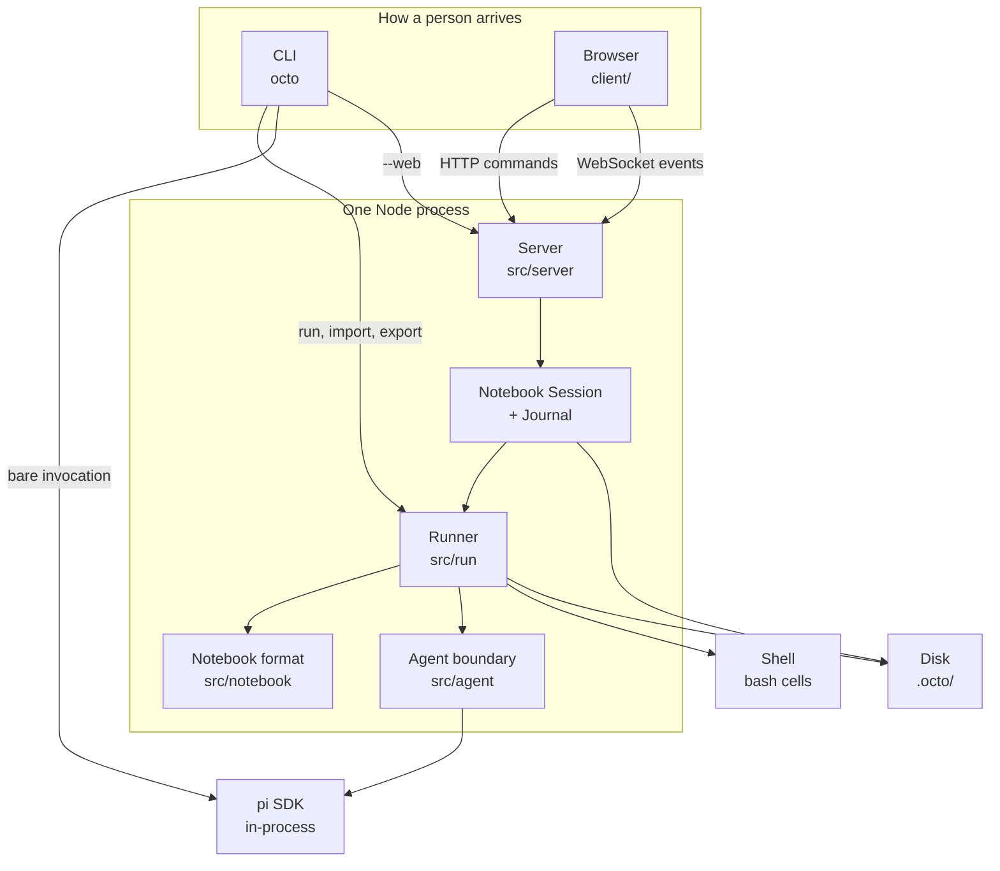

# Architecture

Octo is a notebook environment for agents. A Notebook is a Markdown file. Running it is a separate thing: a Run executes some or all of its Cells, talks to pi only through an agent boundary, and writes a Run Record beside the file. The web interface is a server that owns Notebook Sessions and a browser that watches them. Closing the browser does not stop the work.

The language for the pieces below is [CONTEXT.md](../CONTEXT.md). The decisions that fixed this shape are in [docs/adr/](adr/).

## Shape



Three entry points share one engine:

- `octo run` calls `runNotebook` and prints events to the terminal.
- `octo --web` starts the server. A Notebook Session calls the same `runNotebook`.
- A bare `octo` is not the engine. It hands the terminal to the pinned pi CLI.

Pi is embedded in-process (`createAgentSession`), not driven as a subprocess, for Runs. The subprocess exists only so the launcher can be pi at the terminal. The version is an exact pin: pi ships breaking changes in minor releases.

## Layout

TypeScript on Node 22.19 or newer, ESM. `tsc` compiles `src/` to `dist/`. The browser client is plain JavaScript under `client/`, served as written, with no build step. `npm run typecheck` checks both.

| Path | Owns |
| --- | --- |
| `src/cli/` | The command line. `launcher.ts` decides what was asked. `octo.ts` does it. |
| `src/notebook/` | The document: parse, serialise, Inputs, the Graph, durations, and edits that keep the author's bytes. |
| `src/mode/` | Modes as files. Shipped ones live in `modes/`; a user's own live in `~/.octo/modes/`. |
| `src/run/` | One Run: order, schedule, bash, anchors, staleness, the Run Record, and where it is stored. |
| `src/agent/` | The agent boundary, the pi implementation, a scripted implementation for tests, and the Declared Environment check. |
| `src/pi/` | The parts of pi this program reads: streaming text, one turn's summary, Workspace Trust, the version pin, and handing the terminal to pi. |
| `src/server/` | HTTP, the WebSocket, auth, Notebook Sessions, the Journal, the notebook list, and Promote. |
| `src/import/` | A Chat copied into a Notebook and a Run Record. |
| `src/export/` | A Notebook and one Run written as a single HTML or Markdown document, with credentials struck out. |
| `client/` | Author View and Run View. |

`runNotebook` in `src/run/runner.ts` is the engine's public interface. Tests drive it with the scripted agent and assert on the Run Record. The live pi suite is separate and small: it fails when an upgrade breaks the SDK surface this program uses.

## The Notebook

A Notebook is Markdown with YAML frontmatter, fenced Cells, and Prose between them. The fence tag is the Cell type: `prompt` or `bash`. A `bash` fence with no `id` stays Prose, so a shell snippet in documentation is not a Cell. Attributes on the fence are `id`, `uses`, `isolated`, `approach`, `model`, and `timeout`. A `type` attribute may only restate the tag. `approach` is how a Prompt Cell takes its turn (`agent`, `plan`, or `ask`), and agent is left unwritten. It is not the Notebook's Mode.

Parsing keeps the source in two places: the verbatim text of Prose and Cell bodies, and the verbatim lines that frame them. Serialising replays those bytes. An edit describes the whole Notebook and rewrites only what changed, so a diff of the file is the author's change. The Graph is checked at parse time: every `uses` edge is written by the author, every edge names a Cell, and no chain of edges closes. Document order breaks ties in the run order, so a Cell may be written after the Cell it uses and still run first.

Inputs are declared in frontmatter (`string`, `number`, `boolean`). A Cell body names one as `{{name}}`. `{{artifacts}}` is reserved: it is the directory the Run gives that Cell. `trust` and `no-trust` are reserved too, because those words are the Run's own flags.

A Mode is a Markdown file of its own: frontmatter for a default model, tools, and skills, and a body that is the system prompt. `bare: true` with an empty body sends no system prompt. The Notebook names it. A Run resolves that name and cannot choose another. A user file that collides with a shipped Mode name is refused. A Cell's `model` wins over the Notebook's, which wins over the Mode's. The Notebook's `tools` replace the Mode's when the Notebook lists any. Skills are required either way: a Skill the Notebook declares must be loaded. When the Mode names a skill set, that set plus the Notebook's Skills is the only set the agent is given. When the Mode names none, the agent gets every Skill pi loads.

## A Run

Everything that can stop a Run is settled before the first Cell. A Notebook that fails at the third Cell has already spent the tokens of the first two and may have changed the Workspace.

1. Parse the file.
2. Resolve Inputs. A missing required value, or a value of the wrong type, refuses the Run.
3. Choose the Cells to run and order them on the Graph. Naming a subset filters that order. Dependents are not pulled in.
4. Resolve the Mode, when the Notebook names one.
5. Check that `workspace` is a directory.
6. Create the shared agent. Setting it up is what discovers the Environment: pi loads the Workspace's Skills and Packages while it starts.
7. Check the Declared Environment against that Environment. A mismatch refuses the Run. Nothing is installed or repaired.
8. Run the Cells, then write the Run Record.

Workspace Trust is decided in the open while the agent is created. Pi, asked non-interactively, would assume no and load none of the Workspace's own settings, Skills, and Extensions. `--trust` and `--no-trust` are the Run's decision. Left unset, the decision is what pi has recorded, or a refusal when the Workspace has something gated and nobody has decided. Trust is not a security boundary. There is no sandbox.

### Scheduling

The Graph says what must finish before what. The scheduler adds one more constraint: the shared Agent Session is one message history, so only one Cell may speak into it. An Isolated Cell has a session of its own, made for that Cell and disposed with it, and starts as soon as the Cells it uses have finished. Isolated Cells with no edge between them run at the same time. A Notebook that marks nothing Isolated runs one Cell at a time, in run order.

A Cell that errors, times out, or is interrupted halts the Run. Cells already in flight are waited for. Cells not yet started are left out of the record. Retries are not the Run's: pi retries a transient provider or transport error inside one turn, and the Run records the attempts.

A Prompt Cell is one `agent.prompt`. Thinking, tool calls, and reply text are observed as they happen. A Bash Cell is a shell command in the Workspace, spawned directly, with no agent. Its stdout and stderr arrive whole with the Cell's record.

Each Cell gets a directory, `{{artifacts}}` in its body. Whatever it leaves there is listed by path on the record. The bytes stay on disk.

### Carrying on

Cells in the shared session accumulate one history. Running a Cell again forks that Agent Session at an Anchor: the pi entry the previous turn ended on, which is where this Cell began. Forking adds a branch and removes nothing. An Isolated Cell has no Anchor. Its session is gone when the Cell ends, and a re-run starts empty again. A Bash Cell never enters the session.

Stale is a property of the Run, computed from the whole Graph when the record is written. A Cell is Stale when a Cell it uses has run again since it last ran, or is itself Stale. A selective re-run does not re-run dependents. It marks them Stale.

The Notebook Session does not keep an agent open between Runs. The next Run is given the previous Run Record, reopens the Agent Session named there, and forks at the Anchor. A Notebook edited between Runs is therefore run as it now stands.

### The record

```
<notebook-dir>/.octo/runs/<stem>/<run-id>/record.json
<notebook-dir>/.octo/runs/<stem>/<run-id>/artifacts/<cell-id>/…
```

The record holds per-Cell status (`ok`, `error`, `timeout`, `interrupted`), timings, the model that actually ran, token usage and cost, retries, Anchors, artifact paths, the Environment the Run found, and the ids of Stale Cells. It is written at the end, and also when a Notebook Session finds a Run the process died in the middle of and ends it as far as the Journal got.

## The server

The server binds `127.0.0.1:8008` unless told otherwise. It serves `client/` and the Notebooks under the directory it was started in. A Notebook, for the list, is a Markdown file that parses and contains at least one Cell. `node_modules` and dot-directories are skipped.

One process owns every Notebook Session. Each session runs its own Runs, so one long Run does not hold up another Notebook. The session outlives the browser that opened it.

Commands are HTTP, each with one answer: list, open, run, interrupt, save, duplicate, promote, export, fetch a Run's file, and inspect chat details. What a Run produces is a stream, over a WebSocket at `/api/sessions/<id>/events`. Events are the runner's own (`run-started`, `cell-started`, `cell-text`, `cell-thinking`, `cell-tool-call`, `cell-ended`) plus the session's (`run-ended`, `run-refused`, and the Notebook changing). `/api/chats` lists chats from interactive octo CLI runs, omitting Agent Sessions created for Notebook prompt cells (tracked across completed Run Records and active Journals) so Notebook sessions cannot be deleted through that route. `/api/chats/<id>` serves the full details of a chat: executed commands, outputs, prompt turns, thoughts, and tool call results. When opening a Notebook Session without an existing journal (such as newly promoted from a chat or run from the CLI), previous cell results, text, thinking, and tool call outputs are restored from the latest Run Record.

There is one account. It is proved by the token generated at startup, or by the password stored as a scrypt hash in `~/.octo/password`. Proving it opens a Connection. The browser carries the Connection id as a cookie. A wrong password waits, doubling up to a minute. The shell HTML is served without a Connection, because that is where the browser authenticates. Everything else under `/api/` requires one.

A save sends the whole draft and the Revision it was drawn from, a digest of the file's bytes. A draft made from an earlier Revision — saved by another browser, or changed on disk — is refused rather than written over a file it never saw. The edit path is the same byte-preserving one the format uses.

### The Journal

Every event a Notebook Session emits is numbered and appended, synchronously, to `.octo/journals/<id>.jsonl` under the served directory. The first line records which Notebook was opened and at which Revision. A browser that reconnects asks for everything since the last number it heard. A server that starts reads the Journals, replays each into a session under the same id, and ends any Run the previous process died inside. Pi's session file is not the Journal. It is the Agent Session, and only a Run reopens it, through pi.

## The client

`client/main.js` is the page. The Notebook in view is the URL fragment, with `#run/` selecting Run View. The served directory is drawn beside it, and a small arrow between the columns folds that column away; the choice stays in the browser.

Author View draws the Notebook as written: Prose, each Cell, an interleaved stream of thoughts, tool calls, reply text, and artifacts. Thoughts and tool calls are collapsed by default with click-to-expand, showing tool arguments and execution results. It can run one Cell or all of them, interrupt, edit, duplicate, and export. Each cell's edit button opens an inline editor for that cell in place while keeping other cells in their view. Full edit mode is a form of the whole Notebook — frontmatter, Prose, and Cells — saved in one request.

Run View hides the Cells. It draws the declared Inputs as a form and one button, then how far the Run has got. It is the same Connection as Author View. A value typed into the form reaches a Cell as typed.

The page keeps the sequence number of the last event it applied. A dropped socket reconnects and asks for everything since that number. A background heartbeat checks connection status every two seconds; if the server restarted (answering `401`), the page cleans up active sessions and presents the connect panel automatically. Once authenticated with the new token or password, the browser reconnects and restores the active view.

## Import and export

Import and export sit beside the engine. They produce and consume the same Run Record. They do not run Cells.

Import reads a Chat — a session file pi wrote at the terminal — and writes a Notebook: a Prompt Cell for each message the user sent along the active path, a Bash Cell for each command they ran with `!`. It also writes a Run Record of what those turns already did, read with the same turn summary a live Run uses. Pi's file is copied into the Run's directory and never written. Anchors in the record address the copy, so a later Run can carry on inside the copy. Promote is the same function. The browser picks the Chat from pi's list of the Workspace instead of naming the path. Notebook prompt cell agent sessions are omitted from that list, and chat details can be inspected before promoting. Opening a promoted notebook immediately restores its previous running results, outputs, thoughts, and tool calls from the Run Record.

Export reads a Notebook and one Run (the latest, or the id given) and writes one file. A destination ending in `.md` or `.markdown` is Markdown. Any other name is HTML: Prose, Cells, what each Cell said and cost, and the files it left are inlined, and a content-security policy allows no script and no fetch. Credentials found on this machine are struck out of the document. The Notebook file is unchanged.

## What this process will not do

- It will not sandbox a Cell. A Prompt Cell is an agent with the user's tools. A Bash Cell is a shell command. Binding beyond loopback is a deliberate flag, documented in [remote.md](remote.md).
- It will not put results in the Notebook. The file stays the program. The Run Record is the log.
- It will not infer a Dependency, repair a Declared Environment, or let a Run pick a Mode the Notebook did not name.
- It will not keep a live agent on the Notebook Session between Runs, and it will not treat pi's session file as the session's memory.
- It will not sync an Import back to the Chat it was made from.
